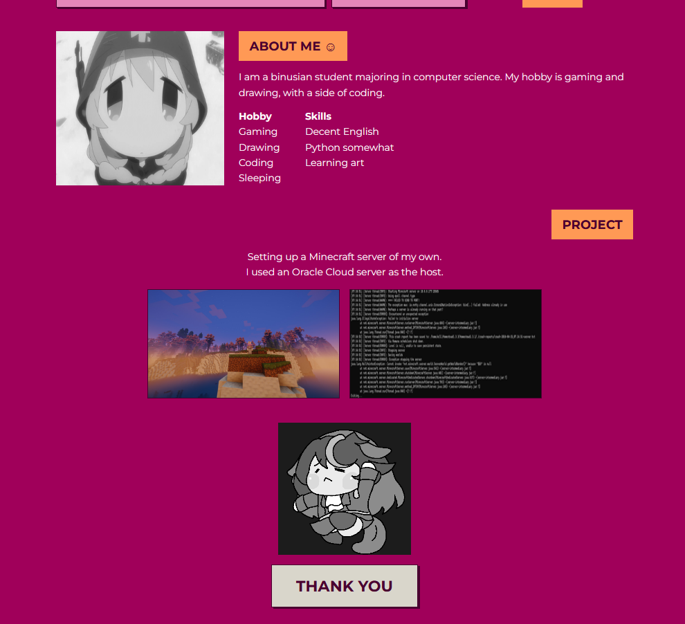

# Portfolios
Attempt number 3
# Personal Portfolio Website

## Project Overview

This is a single-page responsive portfolio website created as part of a lab assignment. The website showcases personal information, projects, skills, and contact details. It is built using **HTML**, and **CSS**.

- URL Link to website portfolio: [Click Here](https://havewilldied23.github.io/Portfolios/)
- URL Link to website design: [Click Here](https://canva.link/7w2kq265xy4qll1)

## Purpose

To create a website to showcase myself/personal branding to my friend and collagues, with also casual customer for commisions.
Not professional lookin, but i would in the future imporve on it.
## Target Audience

This portfolio is designed for:

- Friends, family, Commision customer.

## Technologies Used
- HTML5
- CSS3 (Flexbox, Box Models, Media Queries)

## Layout & Sections

The website includes the following sections:
- **WelcomePage** – Showcasing my photo and jump button, with links
- **About Me** – Short bio and photo
- **Projects** – List of projects with descriptions 
- **Skills** – Technical and soft skills
- **Footer** – goodbye and link

## Responsiveness

The site is optimized for:

- Desktop
- Tablet
- Mobile

## 🧪 How to Run Locally

1. Open your code editor (e.g., Visual Studio Code, etc.).
2. In your code editor, open the terminal.
3. Clone the repository:
   ```bash
   git clone https://github.com/your-username/portfolio-website.git
   ```
4. Open index.html in your browser, or run the website locally using the Live Server Extension.

## 📂 Folder Structure

```bash
portfolios/
│
├── index.html
├── style.css
├── Images/
└── README.md
```

## 📄 Notes

- I used Claude to assist me in planning the html and css code, explaining concepts i am not aware (mostly css), and also helping me fix the codes
- Examples:
    - :root which can create variables like in python, which i can refer to so i can put the name isntead of manually doing hexadecimal
    - a:focus-visible the highlight thing when you hovering on a link box
    - in the nav section, i also learned well before too but a is for all things, so nav a is all nav category of sorts.
    - Theres Units: px is fixed, rem is relative to the base text size, % is relative to the parent, vw is a share of the screen width, fr is a share of the free grid space, and ch is a character width.
    - transform: translate() moves an element without disturbing the others. Together with the hover and active rules, it creates the “pressed button” effect.
    - clamping making the it not go out of bound
    - Html are fine, forgot a bit, mostly referencing the previous files and the internet especially with class name and terms between html and css. Href jump are confusing though.
    - Oh and i for some reason unable to center the project thing.
    
- I designed the color scheme and layout myself using Canva.
- Html i did mostly myself with help from forums. Although claude did somewhat changed the structure at some point a few days ago that i forgot where ;-;.
- I wrote the project descriptions and contact section manually.

## 📸 Screenshots

